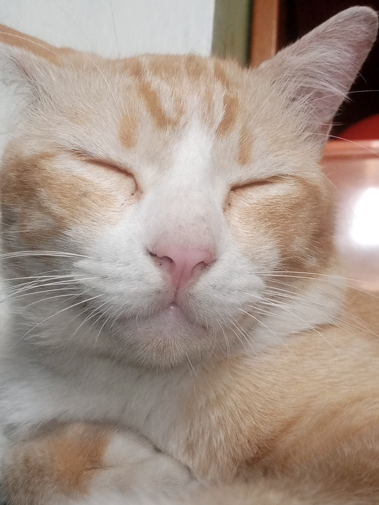

# 💫 About Me:
I'm Alyandra, an aspiring software developer and technology enthusiast with a strong interest in software engineering, cybersecurity, and aerospace technology.  My work focuses on exploring software development, building technical projects, and understanding complex engineering systems. I'm particularly interested in flight software engineering, aircraft design, and the intersection of software and aerospace innovation.  I continuously develop my technical knowledge through independent learning, experimentation, and hands-on projects. My long-term goal is to contribute to meaningful technological advancements through engineering, research, and innovation.

## 🐈 My Cat:
I love my cat so much  :3

  

## 🌐 Socials:

# 💻 Tech Stack:
                         

# 📊 GitHub Stats:
 
 

---

  

